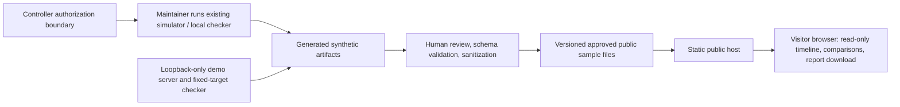

# AegisAI V1: Phase 1 Product Boundary and Threat Model

**Status:** approved direction; Phase 1 planning and documentation only
**Release model:** public research/demo website with reviewed, precomputed synthetic results
**Not a hosted SaaS product.** This proposal does not authorize Phase 2 implementation.

## 1. Product objective and release model

AegisAI V1 will explain and demonstrate simulator-based Purple Team research through static, read-only pages and reviewed sample artifacts. A visitor can inspect a precomputed synthetic Red/Blue episode, its evidence and structured decision explanations, and compare sample local website header assessments. Visitors cannot submit targets, execute simulations, or upload reports.

This is the recommended first release for a student founder with a limited budget. Static hosting can have a low or zero entry cost, needs no always-on application server, database, identity system, or job queue, and keeps the existing simulator and Controller outside the public request path. Its trade-off is that results are curated and not personalized; it is a research/demo and validation surface, not a managed security service. A self-hosted tool could offer local execution but adds installation and support work. A hosted SaaS MVP would add operational, privacy, authorization, and abuse-control obligations before there is evidence of customer demand.

## 2. Initial users and problem

**Initial audience hypothesis:** university cybersecurity educators, student security teams, and security research groups that need a safe, reproducible way to discuss coordinated defensive simulations.

**Problem to solve:** it is difficult to explain how simulated attacker actions, defender observations, authorization decisions, and evidence relate in a repeatable exercise. AegisAI will let these users review a concrete synthetic episode and a narrow defensive header-check example, with provenance and limitations visible alongside the result.

This is a target-user hypothesis to validate through feedback. No customer interviews, demand, or product-market fit are claimed here.

## 3. V1 scope

### Included

- Public informational pages describing the research question, simulator boundary, limitations, and how to reproduce work locally.
- A static dashboard populated only with reviewed, versioned, precomputed synthetic sample data.
- A Red/Blue simulation timeline; selecting an event reveals relevant synthetic evidence and a structured decision trace, including the Controller authorization outcome where available.
- Metrics with labels, units, denominators, scenario/seed and artifact provenance where available. Synthetic values must not be presented as measured real-world security outcomes.
- A baseline-versus-hardened comparison using sanitized sample reports from the local website header assessment. The page must explain that this checks a small set of HTTP headers and status only.
- A downloadable, reviewed sample report in a documented format, with its schema/version, synthetic/local-demo status, generation provenance, and limitations.
- Read-only navigation and local rendering of the shipped data. Public pages do not call the simulator or assessment checker.

### Explicitly postponed

- Hosted SaaS, customer accounts, authentication, tenant separation, roles for customers, billing, subscriptions, and customer data storage.
- Public simulation execution, arbitrary scenario/action inputs, public LLM/provider calls, agent-generated live actions, and automatic memory updates.
- Uploads, report submission, user-supplied URLs, remote scanning, general-purpose vulnerability scanning, and any target outside the local-only demo.
- APIs for customers, integrations, notifications, background jobs, database, analytics, and collection of visitor profile data.
- Production-security certification or claims that the site, checker, simulator, or any target is secure.

## 4. Roles, information, retention, and privacy

| Role | Allowed activity | Information handled |
|---|---|---|
| Visitor | Read static pages, inspect shipped samples, download sample report | No account or submitted data. A download is the same public artifact for every visitor. |
| Maintainer/reviewer | Generate artifacts in the existing controlled workflow; review, sanitize, and publish a selected static release | Synthetic scenario outputs and local demo assessment output; secrets and real target data are out of scope. |
| Hosting/deployment identity | Publish reviewed static files with least privilege | Deployment credentials held by the hosting provider or CI; never embedded in public files or artifacts. |

**Publication data policy:** use synthetic simulator data and the fixed local demo's header-check output only. Inspect every artifact before publication. Reject secrets, personal data, real target identifiers, private paths, hostnames, and unreviewed free text. Do not add visitor analytics or forms in V1.

**Retention:** public sample artifacts remain available as part of the versioned public release until replaced or removed by a maintainer. The hosting platform may create operational access/security logs, potentially including IP address and request metadata. Before launch, choose a host, inspect its logging defaults, disclose relevant logging, and set the shortest practical retention; proposed maximum is 7 days for routine logs, with a documented exception for an active incident. This is a proposed policy, not a confirmed provider capability. No application database or user-submission retention exists in V1. Get jurisdiction-appropriate privacy review before publication.

**Allowed simulation boundary:** the existing deterministic simulator may be run by maintainers in the controlled development/research environment to produce synthetic samples. Published demonstrations replay reviewed artifacts only. The website checker remains local-only and fixed to `127.0.0.1`; it is not exposed as a public feature. Preserve the existing agent-proposal → schema validation → Controller authorization → simulator execution boundary. Public visitors cannot cross it.

## 5. Architecture and data flow

The public host serves static assets and approved JSON. The browser reads only those bundled/public files and renders data as text. It does not reach the Python simulator, Controller, LLM adapter, experiment runner, or local checker. Artifact generation and review stay on the maintainer side. The exact hosting provider, domain, deployment workflow, and log settings are not selected by this Phase 1 proposal.

Preserve the Python simulator, Controller authorization boundary, experiment tooling, local-only website assessment demo, and existing dashboard. The current dashboard contains illustrative hardcoded simulator display data as well as assessment-report import/comparison behavior; do not imply the illustrative values are already validated evidence. Before a public release, each displayed sample needs an identified source artifact and review status.

## 6. Assessment artifact inspection and publication sanitization

Inspected these existing files without editing them:

| Artifact | Observed content | Publication action |
|---|---|---|
| `results/demo_site_assessment.json` | Older hardened-profile result; local URL `http://127.0.0.1:8765/`; header results; no embedded `artifact` path observed | Revalidate against the chosen public schema. Label as local-demo evidence; replace the loopback URL in the public copy with a neutral local-demo label if the endpoint itself is not meaningful to visitors. |
| `results/demo_site_assessment_baseline.json` | Baseline result with four missing headers; includes absolute `artifact` value `C:\AegisAI\results\demo_site_assessment_baseline.json` | Remove the machine-specific absolute path from the public copy. Use a stable relative artifact identifier or omit the field. Label as synthetic/local-demo sample. |
| `results/demo_site_assessment_hardened.json` | Hardened result with four checked headers present; includes absolute `artifact` value `C:\AegisAI\results\demo_site_assessment_hardened.json` | Remove the machine-specific absolute path from the public copy. Use a stable relative artifact identifier or omit the field. Label as synthetic/local-demo sample. |

No secrets or personal data were observed in the inspected report values. This is not a guarantee about future output. Before publishing copies, validate an allowlisted schema, inspect all string fields and nested values, remove absolute paths and machine-specific metadata, check for secrets/personal data/real targets, and preserve the originals as evidence. Do not overwrite or rewrite the source JSON files as part of Phase 1.

The current assessment demonstrates only HTTP status and the four configured response headers (CSP, X-Content-Type-Options, Referrer-Policy, Permissions-Policy). It does not establish application security. The baseline/hardened labels describe the local demo server profiles, not arbitrary websites.

## 7. Public demonstration: complete visitor journey

1. **Landing page:** visitor sees the research/demo purpose, “precomputed synthetic data” label, scope, and explicit limitations before opening a result.
2. **Choose a sample episode:** visitor opens one reviewed scenario. Page shows scenario identifier, seed or reproducibility reference if available, simulator/artifact version, review date, and a clear synthetic-data badge.
3. **Follow the Red/Blue timeline:** events appear in chronological order with actor and action labels. Timeline is immutable and cannot trigger an action.
4. **Inspect an event:** selecting an event shows the synthetic evidence available to the relevant role, evidence identifiers/source, and the corresponding Blue response or lack of response. Role visibility must be respected; do not expose hidden simulator state as defender evidence.
5. **Inspect the decision trace:** show the proposed structured action, validation/authorization outcome, policy reason, and resulting synthetic state/evidence when those fields exist in reviewed artifacts. Present concise structured explanations, not private model chain-of-thought. Clearly distinguish recorded fact from explanatory summary.
6. **Review metrics:** show metric definition, numerator/denominator, units, scenario/seed, and synthetic caveat. If provenance or denominator is unavailable, omit the metric instead of guessing.
7. **Compare website assessments:** visitor switches between baseline and hardened local-demo reports. Show observed/expected header values, finding counts, and which findings are resolved. Explain that the comparison covers only the configured response headers and HTTP status, not general vulnerability assessment.
8. **Download sample report:** visitor downloads a sanitized static sample report with schema/version, local-demo/synthetic designation, provenance, and limitations. No form, upload, or report generation is involved.
9. **Reproduce or learn more:** link to repository instructions for running the bounded local demo and research tooling. Any reproduction occurs locally under maintainer/user control, not from the public website.

At no point does the public journey ask for a target URL, accept user data, execute a simulation, call an LLM, or perform a scan.

## 8. Threat model

| Threat / abuse case | Impact | V1 mitigation and required review |
|---|---|---|
| HTML/script injection through a report string or event text | Script execution in visitor browser; defacement or data theft | Treat every artifact string as untrusted; render with DOM text APIs, never concatenate untrusted HTML; schema and size limits; CSP; tests with script and event-handler payloads. |
| Private path, secret, or personal data accidentally published | Information disclosure | Allowlisted artifact schema; pre-publication scan/review; remove absolute paths and secret-like values; publish sanitized copies only; keep source evidence unchanged. |
| Public feature abused to scan third parties or access internal services | Unauthorized scanning/SSRF | No target input, upload, public checker endpoint, or server-side URL fetch. Keep checker fixed to loopback. Verify static hosting has no hidden proxy/API route. |
| Public visitors trigger expensive simulation or provider calls | Compute/cost abuse and uncontrolled actions | Ship precomputed data only; no public run endpoint, queue, or LLM call. Keep Controller and provider adapter outside public data flow. |
| Synthetic output mistaken for a real incident or security guarantee | Bad decisions, reputational harm | Persistent synthetic/sample labels, provenance and limitations beside charts/reports; name the narrow header-check scope; avoid production-ready/security claims. |
| Poisoned artifact or prompt-like text influences display or later automation | Misleading result or execution if reused | Treat artifact values as data, not instructions; no public LLM; validate schema; human review; never automatically feed public samples into Controller or memory. |
| Evidence visibility leaks hidden state or role-restricted data | Misleading or unfair evaluation | Publish only reviewed evidence fields; verify each event's role visibility; keep hidden state out of defender-facing evidence. |
| Compromised repository or deployment credential changes public artifacts | Malicious content or defacement | Least-privilege deployment identity, protected credentials, reviewed changes, dependency-free static delivery where possible, release checks, and rollback procedure. Hosting controls remain to be selected. |
| Hosting logs collect more visitor data than expected | Privacy exposure | No application analytics/forms; inspect provider defaults, disclose and minimize logs, configure short retention, restrict log access. |
| Large/malformed JSON stalls browser or produces misleading rendering | Availability or unsafe parser behavior | Bound artifact size and nesting/entry counts; parse errors fail closed with a useful message; validate required fields and enum values; tests for malformed and oversized reports. |

Residual risk remains: static hosting, browser rendering, maintainer devices, repository access, and provider configuration still require secure operation. This document is a product threat model, not a security certification.

## 9. Focused verification plan

These are proposed acceptance tests for the relevant existing components and future public sample import path. Do not add dependencies or build the public site during Phase 1.

### Assessment checker

- Hardened local profile returns HTTP 200 and the expected four configured headers; output schema, profile, status, and finding count are consistent.
- Baseline profile returns HTTP 200 and reports exactly the intentionally absent configured headers; hardened profile reports no findings.
- Checker remains fixed to `127.0.0.1` and does not gain an arbitrary URL/host option; tests verify the requested scope cannot be redirected to external or internal targets.
- Connection refusal/timeouts return a structured failure without traceback or stale success artifact. Verify output file behavior on failure.
- Validate malformed/missing response data and unexpected profile values fail clearly; output JSON remains parseable and follows a stable schema.
- Public-copy sanitizer removes absolute Windows/Unix paths, secret-like values, and unapproved fields while preserving the original input file byte-for-byte.

### Dashboard report import and comparison

- Valid baseline and hardened reports import individually and together; comparison counts derive from finding IDs and statuses, not hardcoded claims.
- Malformed JSON, empty files, wrong root type, missing required fields, unsupported schema version, invalid status/profile, duplicate report selection, and more than two reports produce clear errors without breaking the dashboard.
- HTML/script payloads in every displayed string (for example `` and ``) are displayed as inert text; test that no script executes and no event-handler node is created.
- Oversized JSON and excessive arrays/nesting are rejected with a bounded error; user can clear/reselect a report after a failure.
- Comparison distinguishes absent, incorrect, and present values and never describes the narrow header check as a full security assessment.
- Keyboard operation and accessible labels cover file selection, error status, comparison, and download.

## 10. Phase 1 acceptance and completion checklist

- [x] Release direction approved: public research/demo site with reviewed precomputed synthetic results; no hosted SaaS.
- [x] V1 scope and visitor journey reviewed and approved, subject to the stated safety boundaries. The audience remains a hypothesis; no customer interviews, demand, or product-market fit are claimed.
- [x] Publication disposition documented for all three inspected assessment artifacts; original evidence files remain unchanged.
- [x] Sample report provenance and limitations are specified.
- [x] Focused checker and dashboard import/comparison test cases, including malformed JSON and injection attempts, are documented for Phase 2 implementation.
- [x] Preservation requirements are recorded: Python simulator, Controller authorization boundary, experiment tooling, loopback-only checker/demo, and existing dashboard.
- [x] This Phase 1 review introduced no public execution, remote scan, upload, LLM call, account, billing, dependency, or application implementation.
- [x] Phase 1 document and current working tree reviewed; Phase 2 remains gated on separate approval.

**Verification for this documentation-only phase:** inspect the diff and confirm no `results/` evidence files or application code changed; run the existing Python test suite and `git diff --check`. Passing tests demonstrate repository checks only, not production readiness.

## 11. Documentation changes

### Created in this Phase 1 proposal

- `docs/PHASE1_PRODUCT_BOUNDARY_AND_THREAT_MODEL.md` — approved V1 boundary, audience hypothesis, data/privacy policy, artifact sanitization, user journey, architecture, threat model, test plan, and completion checklist.

### Proposed after review / before a public release (not changed here)

- `README.md`: add a concise public-demo boundary and link to the approved product/threat-model document; clarify which dashboard values are illustrative versus evidence-backed.
- `frontend/README.md` (or equivalent dashboard guide): describe the accepted static report schema, safe import/comparison behavior, synthetic labels, download format, and import limitations.
- `demo_site/README.md`: retain its developer-only, loopback/fixed-target status; explain baseline/hardened sample provenance and reiterate it is not a public scanner.
- `PROJECT_HANDOFF.md`: record the approved release model and current phase gate so future work does not drift into SaaS or public execution.
- A release checklist/privacy notice: document selected host, domain, provider log behavior/retention, contact/reporting route, artifact review sign-off, and rollback. Draft only after host and jurisdiction are selected.

No README, source artifact, application code, or dependency manifest is changed by this proposal. Phase 2 implementation and publication await your review.
