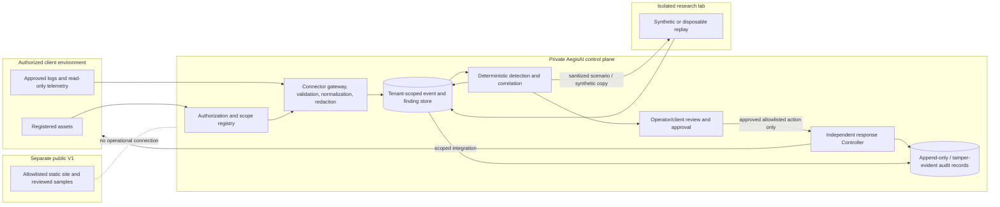

# AegisAI Platform Vision — Phase 0 Architecture and Threat Model

> Historical proposal dated 2026-10-22. The capability matrix, repository observations, and test counts below describe that review, not the current checkout. For present-day behavior and checks, use [CURRENT_STATUS.md](CURRENT_STATUS.md), [development setup](DEVELOPMENT.md), and the [documentation index](README.md).

**Implementation since this proposal:** a separate loopback-only API, schema-v6 SQLite store, bounded synthetic telemetry scheduler, investigations, assessment/report views, and local operations dashboard now exist. They remain synthetic developer tools; they do not implement the customer-facing SaaS, production identity, or response integrations proposed here. Public pages still serve reviewed static samples without calling that API.

**Status:** Proposed architecture; Phase 0 review document, not authorization to build or deploy a client-facing service.  
**Date:** 2026-10-22

## Executive recommendation

Keep the existing public V1 as a static, read-only research/demo website. Do not connect it to client infrastructure or the Controller. Build the next increment as a separate, local-only synthetic-data prototype. It should exercise asset, finding, evidence, incident-timeline, and report data contracts without a web server, credentials, external connections, a database, or a scheduler.

For later private operations, start with a modular control-plane service and clear domain boundaries, not a fleet of microservices. Add durable storage, authentication, tenant authorization, connectors, scheduling, and response integrations only in separate approved phases. The present repository does not provide these SaaS capabilities.

## Verified repository state

The inspected checkout is branch `main`, commit `9107b0b` (`feat: add assessment report validation and parsing functionality`), tracking `origin/main`. Existing uncommitted working changes were present before the Phase 0 documentation work; preserve them. The Python project uses Pydantic and pytest, and the frontend is React + TypeScript + Vite. No web framework, database client, authentication framework, durable job system, cloud deployment configuration, or production connector is present in the declared dependencies.

The last baseline runs for this review were:

- `python -m pytest -q`: **200 passed**, with one `PytestCacheWarning` because Windows denied access to `.pytest_cache`.
- `npm test` from `frontend/`: strict TypeScript check and Vite build passed; **20 Vitest tests and 3 static-release tests passed**.
- The package tree is installed from the pinned `frontend/package-lock.json`. These checks exercise the local research/demo code; they do not establish service readiness or customer-environment security.

## Capability matrix

| Capability | State | Verified implementation and boundary |
|---|---|---|
| Seeded synthetic environment and scenarios | **Implemented** | `environment/` models deterministic hosts, services, vulnerabilities, actions, transitions, and synthetic events. It is not a client asset scanner. |
| Agent decision proposals | **Implemented for research** | Scripted and LLM Red/Blue agents return typed actions from role-specific observations. They do not directly mutate simulator state. |
| Controller authorization | **Implemented, simulator-scoped** | `controller/` validates action types, role/phase, allowlisted simulator actions, and per-step limits before execution. It has no tenant, client ownership, asset-scope, approval, or production integration model. |
| Audit and explainability | **Partial** | Controller-owned action audit and XAI traces exist, but sinks are in memory and are not durable, tamper-evident, tenant-scoped operational records. |
| Telemetry and detection | **Implemented only in simulation** | `telemetry/` models synthetic events, alert rules, and role-filtered observations. `TelemetryLogger` is in memory; there are no production log/endpoint/cloud connectors or generic client-log detections. |
| Threat-intelligence retrieval | **Implemented as offline foundation** | `threat_intelligence/` normalizes curated records and performs deterministic lexical retrieval. It has no live feed ingestion, vector service, or verified universal MITRE mapping. Retrieved content is treated as untrusted data. |
| Adaptive memory and experiments | **Implemented as research tooling** | Validated knowledge patches, scenario splits, offline experiment harnesses, metrics, and reports exist under `memory/` and `evaluation/`. They are not a customer operations scheduler or detection service. |
| External LLM provider | **Partial, explicit research integration** | `llm/openai_provider.py` and bounded `evaluation/live/` flows can call a model when explicitly enabled and configured. The live experiment still runs against the local synthetic simulator; it is not client telemetry processing. Never send client data through this path by default. |
| Public frontend | **Implemented, static/read-only** | Vite builds the landing, dashboard, and privacy pages; the dashboard replays reviewed synthetic JSON and performs local browser-side assessment import/comparison. It has no backend API or client accounts. |
| Local website header demo | **Implemented, loopback-only** | `demo_site/server.py` and `scripts/check_demo_site.py` check a fixed local target and selected response headers. They are not arbitrary-target scanning or production assessment services. |
| Customer/tenant onboarding and authorization registry | **Missing** | No customer identity, ownership evidence, scoped asset enrollment, expiry, revocation, exclusions, test windows, or emergency contacts. |
| Multi-tenant authentication and isolation | **Missing** | No login, RBAC, tenant-aware API, data store, authorization middleware, or cross-tenant isolation tests. |
| Continuous collection and scheduled workflow | **Missing** | No event ingestion service, durable queue, scheduler, overlap lock, retry/idempotency layer, or per-customer 10-minute cycle. |
| Production vulnerability/security assessment | **Missing** | No customer-target scanning, active assessment, or approved client telemetry integration. Do not infer these from the local header checker. |
| Production incident dashboard, notifications, and reporting | **Missing** | Existing dashboard and reports are local research/demo artifacts, not tenant-specific operational workflows. |
| Defensive action against client systems | **Missing** | Blue actions are simulator operations. No WAF/IAM/EDR connector, human approval workflow, production rollback, or response verification exists. |

## Product boundaries and trust model

### Public V1 invariant

The public website remains static and read-only. It serves reviewed synthetic or sanitized artifacts only. It does not expose the Controller, simulator execution, client APIs, arbitrary target input, uploads to a server, production LLM calls, credentials, or operator actions. Keep its strict publisher allowlist and security headers. Any operational service must be a separately deployed private service with separate credentials and network policy.

## Technology tradeoffs

- **Prototype:** retain Python and Pydantic already used by the simulator and schemas. A local deterministic CLI avoids new runtime services and dependencies while allowing contracts and evidence provenance to be reviewed.
- **Private API (later):** the repository currently has no web framework. FastAPI would fit the existing Pydantic models and typed API style, but authentication, tenant authorization, admin workflows, and secure defaults would still need deliberate design. Django provides more integrated authentication, ORM, migrations, and admin, but introduces a broader framework and a different application structure. Select only after the team chooses an identity provider, operator/client workflows, hosting constraints, and security ownership. Do not implement custom authentication as a shortcut.
- **Persistence (later):** PostgreSQL is a reasonable candidate for relational tenant/scope/job/audit metadata and transactional authorization checks. It adds schema migration, backup, access-control, and operational cost; it is unnecessary for the synthetic Phase 1 CLI.
- **Scheduling (later):** first compare a durable database-backed job/lease table with a managed queue using expected tenants, connectors, and concurrency. Redis/Celery or a cloud queue may improve scale and retry operations, but add deployment and failure modes. Do not introduce them before the workload and idempotency model are known.
- **AI:** existing provider abstraction is suitable for bounded simulator experiments only. For client data, default to deterministic detection and no external model call. Review provider data handling, tenant opt-in, redaction, and cost before any optional investigation feature.
- **Frontend:** preserve the current Vite static multi-page app for public V1. A future authenticated client dashboard may be a separate application that calls only the private API; do not add operational endpoints to the static publisher.

### Proposed data flow

### Component responsibilities

| Component | Responsibility | Required boundary |
|---|---|---|
| Client dashboard | Display a tenant's authorized assets, evidence-backed findings, incident state, reports, and approval requests. | Authenticated; tenant identity enforced server-side on every request; never trust tenant IDs supplied only by the browser. |
| Private control plane | Identity, role checks, authorization registry, policy, job lifecycle, approval state, connector configuration, and audit orchestration. | Private network; least privilege; explicit tenant and asset scope; no public frontend route to internal services. |
| Collection layer | Pull approved read-only telemetry; validate, normalize, bound, deduplicate, and redact before persistence or model use. | Connector identity and asset scope checked for every pull; external strings are data, never instructions. |
| Detection/investigation | Deterministic rules and evidence correlation first; optional AI may summarize or recommend only from a bounded evidence packet. | Evidence references, confidence, uncertainty, and rule version stored; AI has no execution credentials or arbitrary tools. |
| Isolated lab | Run harmless fixtures or disposable authorized replicas; assess expected vs observed detections. | Separate network and credentials from client production; no route from replay job to production; strict CPU, memory, duration, and egress limits. |
| Response Controller | Independently authorize only typed, allowlisted, tenant-scoped actions and enforce rate, impact, expiry, approval, and emergency-stop rules. | AI cannot call integrations directly or override policy; start in simulation mode; verify outcome before reporting success. |
| Reports/notifications | Present evidence references, status, limitations, and approved recommendations. | Tenant-scoped destinations; redact secrets and personal data; no unverified “resolved” claims. |

### Trust boundaries

| Boundary | Crossing | Enforcement expectation |
|---|---|---|
| TB1 — Public site / private service | Anonymous browser vs operational control plane. | No operational API or credential path from the static site; separate origin/deployment and network policy. |
| TB2 — Client / connector | Client telemetry source enters a connector. | Written authorization and source identity; connector may read only registered assets and approved data classes. |
| TB3 — Connector / ingestion | External provider response enters AegisAI processing. | Authenticate provider; bound bytes, records, time, rate, and schema; normalize/redact; treat all strings as untrusted. |
| TB4 — Tenant / control plane | User or job references tenant-owned resources. | Derive tenant from authenticated identity; check scope server-side at every operation; never rely on UI filtering. |
| TB5 — Control plane / AI provider | Bounded evidence is sent to an optional model. | Default off; no secrets or unbounded raw logs; tenant opt-in and provider/privacy review; model has no integration credentials or tools. |
| TB6 — Production / research lab | Synthetic replay or disposable copy enters test environment. | Separate credentials and network; no production routes; sanitize copied evidence; resource/egress limits and automatic teardown. |
| TB7 — Decision / response integration | Proposed action crosses into an external security provider. | Only Controller identity may call; re-check tenant, asset, approval, action allowlist, expiry, budget, and emergency stop. |
| TB8 — Application / audit store | Operational records are persisted. | Separate append-only write path and least-privilege read access; tamper evidence and retention policy; log access itself. |

## Bounded continuous workflow

The “10-minute cycle” is a proposed maximum cadence for processing already-authorized low-impact telemetry, not permission to scan or attack assets every 10 minutes. Event-driven urgent telemetry should be handled promptly when a supported connector exists. Separate the following schedules:

- **Event processing:** event-driven where available; bounded polling fallback per connector.
- **Low-impact posture checks:** no more frequently than an explicit per-asset schedule, initially perhaps every 10 minutes after scope and load review. These are deterministic and read-only.
- **Vulnerability assessments:** separately scheduled, explicitly enabled per asset/method, rate-limited, and approved. Never implied by the telemetry cycle.
- **Attack replay:** only in the isolated lab using synthetic data or disposable authorized replicas; on demand or after a relevant change, not against production by default.
- **Defensive response:** default off. Start with recommendations and simulated actions; require explicit approval policy before any real connector action.

Every future job must re-check authorization and scope, use a unique tenant/scope/idempotency key, reject overlapping runs, enforce deadlines and concurrency/rate budgets, retry only idempotent work with bounded backoff, and fail closed on stale authorization, missing data, connector errors, or ambiguous outcomes. Record `not_run`, `incomplete`, `failed`, or `verified` distinctly; never translate missing evidence into success.

When the private service phase is approved, one bounded processing cycle should follow this order:

1. Confirm tenant status and that the authorization has not expired or been revoked.
2. Resolve the job to the verified tenant, registered assets, allowed data classes, methods, exclusions, and time window.
3. Acquire the tenant/scope overlap lock and an idempotency key; reject duplicate active work.
4. Retrieve only approved read-only telemetry within byte, record, time, and rate limits.
5. Validate schema, normalize timestamps/identifiers, deduplicate, and redact secrets/personal data before storage or model use.
6. Run deterministic checks for configured indicators, vulnerabilities, and configuration drift; record unavailable checks as incomplete.
7. Correlate with tenant-scoped history and verified technique/reference mappings; do not invent mappings.
8. Calculate explainable severity/confidence factors and preserve evidence references, rule versions, and uncertainty.
9. Queue an optional lab replay only using synthetic or approved disposable copies; never replay in production.
10. Evaluate response eligibility against a fixed action allowlist and current scope; the default result is recommendation-only.
11. Obtain a fresh human approval when required, bound to exact tenant, asset, action, evidence, and expiry.
12. If separately enabled, let the independent Controller—not the AI—authorize and invoke the scoped integration with rate/impact limits.
13. Verify resulting state through the approved integration; if ambiguous, report incomplete and escalate. Use only a pre-approved rollback when supported.
14. Append audit state, update tenant views, and send only approved notifications; do not report success without verified completion.

## Data policy proposal

The local Phase 1 prototype should use synthetic fixtures only and retain data in process or a generated local artifact. It should not include real names, customer identifiers, credentials, raw production logs, or externally sourced personal data.

For any future private pilot, data categories requiring explicit product/legal approval include tenant and user identifiers, asset identifiers and authorization evidence, bounded telemetry records, derived findings, evidence references, approval decisions, and audit events. Minimize raw log retention; redact secrets before persistence and before any model context; avoid storing full payloads where a narrow evidence excerpt or stable reference suffices. Do not send customer telemetry to an external model by default. Any opt-in model processing needs a reviewed provider/data-processing decision and tenant-visible controls.

Retention periods, residency, deletion/export, subject requests, breach handling, and audit retention are **open decisions**; this document does not invent legal periods. Resolve them by customer segment, contract, and applicable law before collecting real client data. Credentials, when integrations are later approved, must be held by a dedicated secret store and exposed only to narrowly scoped connector workers, never frontend assets, model prompts, logs, or reports.

## Threat model

### Assets to protect

Tenant and user identities; proof and scope of authorization; asset inventory; security events and evidence; findings and incident status; connector credentials; approval and response records; audit history; lab isolation; and integrity of reviewed public artifacts.

### Threats and proposed mitigations

| Threat | Example abuse | Required mitigation before the relevant phase |
|---|---|---|
| Cross-tenant exposure | User changes an object ID to read another customer's finding. | Tenant-scoped authorization in service/domain queries; deny-by-default; isolation tests across every object and report path. |
| Unauthorized enrollment | Attacker registers a third-party domain or IP as theirs. | Out-of-band ownership/authorization verification; explicit scope, methods, exclusions, windows, expiry and emergency contact; no scan until verified. |
| Compromised connector | Stolen token reads extra assets or injects false events. | Per-tenant least-privilege identity; narrow scopes; rotation/revocation; response-size and rate limits; source identity/provenance; isolated worker and egress allowlist. |
| Prompt injection in logs/web content | Log line tells an AI to ignore policy or reveal secrets. | Treat all collected content as quoted data; no instruction-following from evidence; schema/size limits; evidence-only model input; no tools or credentials for AI. |
| Malformed/hostile telemetry | Oversized, duplicated, deeply nested, or encoded payload exhausts parsers or pollutes detections. | Bounded reads before buffering; strict schema, size/depth/rate limits; normalization; deduplication; quarantine and adversarial tests. |
| AI hallucination/false positive | Unsupported claim becomes a customer incident or block request. | Deterministic evidence-backed findings first; record rule/model version and evidence; calibrated confidence/uncertainty; human review; no action from unsupported text. |
| Controller bypass | AI or API caller invokes a provider integration directly. | Separate Controller service identity; typed action allowlist; independent scope/policy re-check; integration secrets unavailable to AI and web tier; bypass tests. |
| Stolen credentials | Token leaks from logs, frontend, prompts, or workstation. | Secret manager; short-lived scoped credentials; rotation/revocation; redaction; audit use; never place production secrets in repo or public build. |
| Queue poisoning/replay | Forged or replayed job causes duplicate response. | Authenticated job producer; signed/validated envelope; tenant/scope binding; idempotency keys; expiry and replay protection; bounded retry. |
| SSRF/internal metadata access | User-supplied URL causes worker to access cloud metadata or private services. | Do not accept arbitrary targets/URLs; connector destinations from verified registry; strict DNS/IP egress policy and redirect revalidation. |
| Excessive assessment/DoS | Many tenants schedule overlapping checks or simulations. | Per-tenant/asset budgets, global concurrency limits, queue back-pressure, timeouts, circuit breakers, separate assessment schedules, emergency stop. |
| Audit tampering | Operator or compromised service edits/deletes evidence of a response. | Append-only storage with separate write/read roles; hash chaining or external immutable retention; trusted timestamps; verify audit continuity. |
| Unsafe or incorrect response | Wrong host is blocked; stale approval is reused. | Default response disabled; exact tenant/asset/action binding; evidence/confidence threshold; approval expiry; rate/impact cap; dry run; post-action verification and tested rollback. |
| Secret/PII leakage | Raw logs or identifiers appear in LLM context or report. | Data minimization, redaction before storage/model/report, retention controls, access audit, output review, synthetic fixtures in tests. |

Residual risk remains until a specific private implementation has been threat-modeled and independently tested. This model is not a security certification.

## Smallest practical Phase 1 proposal

Create a **local-only synthetic data prototype**, separate from the public V1 and existing simulator execution path. Reuse Pydantic already in `requirements.txt`; add no dependency in the first increment. It should load a checked-in synthetic fixture and produce deterministic asset inventory, findings with evidence references, an incident timeline, and a JSON report. It should have no HTTP listener, credentials, external network calls, AI calls, real log ingestion, database, scheduler, or response integration.

Proposed new files, subject to approval:

- `platform_prototype/__init__.py`: local prototype package boundary.
- `platform_prototype/models.py`: strict synthetic asset, finding, evidence, incident, and run-result schemas.
- `platform_prototype/fixtures/demo_environment.json`: clearly labeled synthetic assets/events only.
- `platform_prototype/pipeline.py`: deterministic fixture-to-findings/timeline/report flow.
- `scripts/run_platform_prototype.py`: local CLI that reads only the fixed fixture and writes to a new explicit output path.
- `tests/unit/test_platform_prototype.py`: schema, provenance, deterministic results, malformed/oversized input, and injection tests.
- `docs/PLATFORM_VISION_PHASE1_LOCAL_PROTOTYPE.md`: scope, run instructions, and explicit non-capabilities.

The public V1 source, publisher allowlist, and deployed/static output remain unchanged. Reusing `environment/` is appropriate only for the replay side after the data contracts are reviewed; the asset/finding prototype must not imply that simulated actions are client detections.

## Roadmap and approval gates

| Phase | Increment | Gate before proceeding |
|---|---|---|
| 0 — Requirements and design | This capability inventory, boundaries, architecture, threat model, and open decisions. | Owner review of target customer, data policy, and Phase 1 prototype contract. |
| 1 — Local synthetic prototype | Deterministic local asset/finding/incident/report flow; no server, real data, new deps, or public V1 changes. | Review schemas, labels, tests, and separation from simulator before accepting. |
| 2 — Private service foundation | Select framework after identity/hosting requirements; authentication, tenant isolation, verified authorization registry, policy service, durable audit. | Security design review and tenant-isolation test gate before any real data. |
| 3 — Read-only telemetry | Approved connectors, normalization/redaction, deterministic detections, durable idempotent jobs and schedules. | Connector scope, data retention, load, failure, and incident procedures approved. |
| 4 — Isolated replay | Disposable lab, harmless replay scenarios, detection gap/regression metrics. | Prove no production route/credential access and bounded resource use. |
| 5 — Controlled response | Initially simulated allowlisted actions; then separately approved integrations with human approval, verification, rollback, and emergency stop. | Independent Controller tests, tabletop, and customer-specific action approval. |
| 6 — Limited pilot | Explicitly authorized test assets, operational monitoring and incident response. | Contract, written scope, support process, privacy terms, and security review. |
| 7 — Production readiness | Reliability, security, privacy, support, disaster recovery, performance, and legal review. | Separate documented launch approval; no automatic graduation from pilot. |

## Open decisions before Phase 1

1. Which initial customer/user persona should the synthetic prototype demonstrate: internal security team, MSP, or small organization owner?
2. Which asset fields and evidence references are necessary for the demonstration, and which should be excluded?
3. What local report format and output handling are acceptable for the prototype?
4. Confirm that Phase 1 remains offline/synthetic and does not modify the public frontend or simulator/Controller contracts.
5. Defer hosting, identity, database, queue, model provider, retention period, and response integrations until requirements and budget are reviewed.

